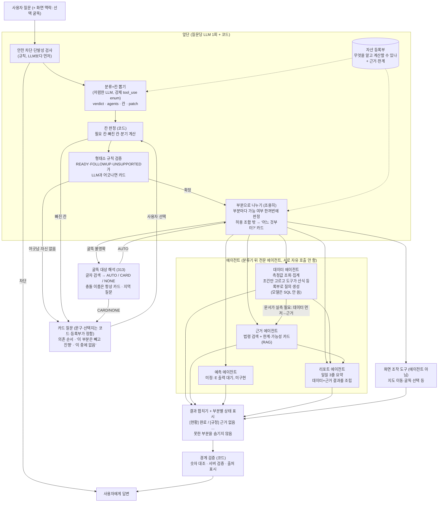

# 에이전트 오케스트레이션 구조 (같이 고치는 초안)

[명세](spec.md) · 상태: **초안. 사용자와 같이 고치며 세부를 정한다.** 2026-11-18

이 그림은 2026-11-17~18에 합의한 틀([기억 요약은 spec.md의 합의 목록](spec.md))을 한 장으로 옮긴 것이다. 합의되지 않은 칸은 `미정`으로 표시했다. 고칠 때는 아래 Mermaid 블록과 "세부 결정 칸" 표를 같이 고친다. (VS Code의 Markdown 미리보기나 mermaid.live에 붙이면 그림이 보인다.)

## 1. 전체 흐름

## 2. 합의된 규칙 (그림에 들어간 것)

| 규칙 | 그림의 위치 |
|---|---|
| 맨 앞 저렴한 LLM이 분류하고 에이전트로 분기 | CLS |
| 모델은 SQL을 쓰지 않는다. 조건만 고른다 | DATA |
| 안전장치(차단·숫자 대조·서버 검증)는 앞단·경계에 둔다 | SAFE, GUARD |
| 자산 등록부가 "일을 보낼지 말지"를 정한다 | REG → CLS, PLAN |
| 복합 질문: 부분으로 나눠 한꺼번에 판정, 불가능한 부분은 묻지 않음 | PLAN |
| 카드는 의존 순서, 부분 답변 허용, "빼고 진행" 선택지 | CARD, MERGE |
| 카드 문구와 선택지는 코드·등록부가 정한다(모델이 쓰지 않음) | CARD |
| 처음 허용 조합: 데이터+문서, 예측+문서, 데이터+화면. 밖은 "어느 것부터?" 카드 | PLAN |
| 화면 조작은 에이전트가 아니라 도구 | UI |
| 굴뚝 이름은 법인 표기 없이 매칭하고 모호하면 지역을 물어 방어 | TARGET |

## 3. 세부 결정 칸 (같이 정할 것)

| # | 칸 | 지금 초안 | 결정 |
|---|---|---|---|
| O1 | 에이전트가 정확히 몇 종인가 | 4종 + 화면 도구 | |
| O2 | 분류를 LLM 하나로 할지(D1) | LLM이 칸을 뽑고 코드가 판정, 규칙은 검증 | |
| O3 | 예측 에이전트의 입력·출력 형식(D14) | 미정, E 출력 대기 | |
| O4 | 리포트 에이전트가 직접 데이터를 조회하나, 두 에이전트 결과만 조립하나 | 조립만 | |
| O5 | 다단계 도구 루프의 범위 | 미정 | |
| O6 | 문서 조건 카드를 대화 안 선택지로 옮길지 | 미정 | |
| O7 | 근거 에이전트가 데이터 결과를 받아 쓰는 방식(순차 vs 병렬) | 데이터 먼저→근거 순차 | |
| O8 | 비데이터 질문에서 부족한 조건 처리 | 카드로 안 풀릴 수 있어 논의 중 | |
| O9 | 서버 구현 위치(D3) | Python 서버 정본 | |
| O10 | 선택 굴뚝 전달(D10) | 프런트가 요청에 싣는다. 굴뚝 조회는 제한 없음 | |

결정되면 "결정" 열을 채우고 그림을 고친다. 결정에 따라 [314 spec.md](spec.md)의 D 항목과 [tasks.md](tasks.md)도 갱신한다.
